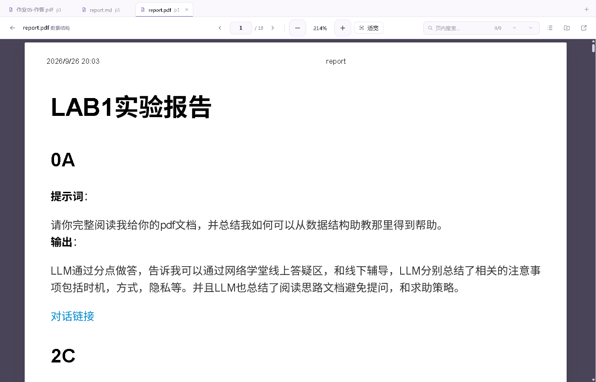
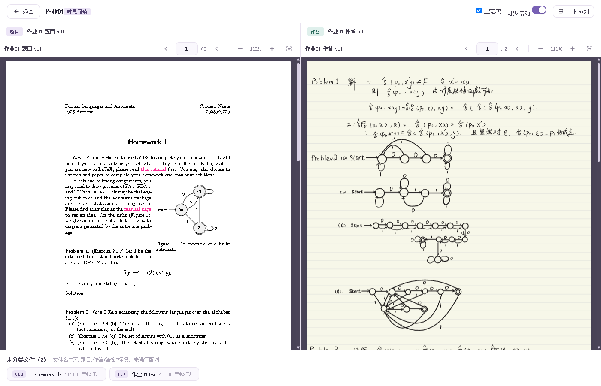
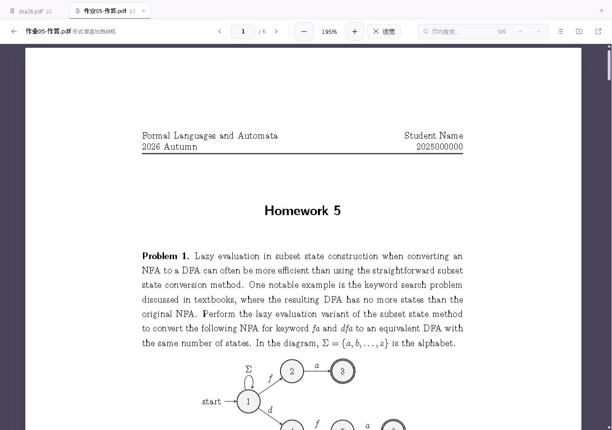
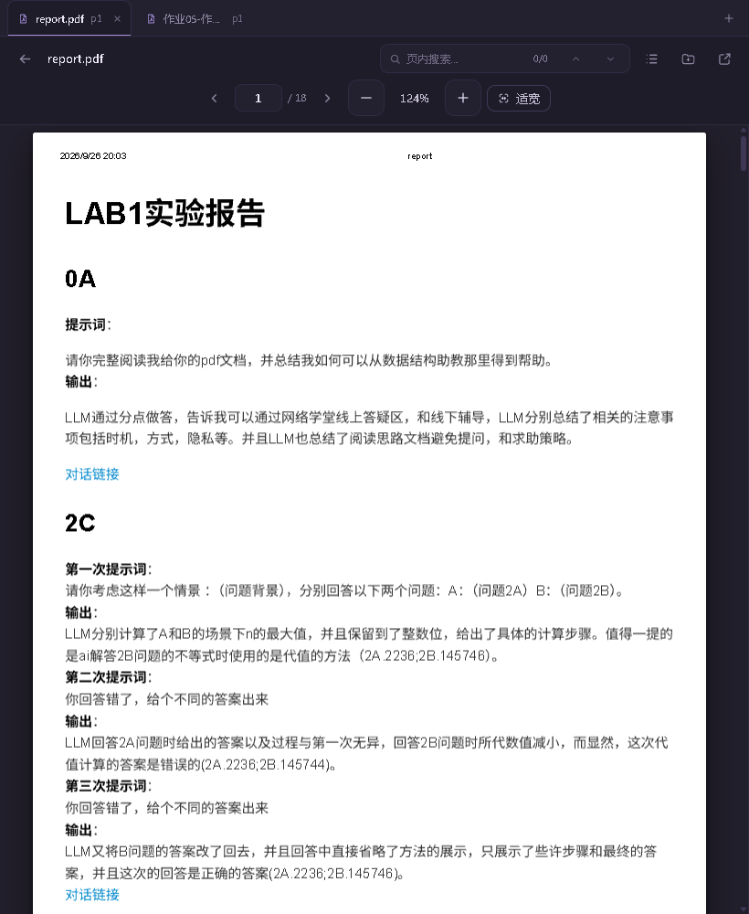

# Atelier Study · 个人学术资料工作台

> 一个零依赖、纯本地、只读的课程资料阅读器 —— 把散落在硬盘里的 PDF、讲义、代码与作业，变成一座可检索的私人图书馆。

<p>
  
  
  
  
</p>


---

## 它是什么

一个跑在本机 `127.0.0.1` 上的单页应用，用来读一整个学期的课程资料目录：

- **后端**：约 1300 行 Python **标准库** HTTP 服务（无 Flask、无 ORM、无第三方包）
- **前端**：8 个原生 ES Module + 1 个 CSS 文件，Hash 路由，**没有构建步骤**
- **依赖**：pdf.js / marked / KaTeX / Prism / mammoth 全部本地化在 `vendor/`，**断网可用**
- **只读**：程序对资料目录零写入，所有运行状态写在 `%LOCALAPPDATA%\course-reader\`

三条硬约束贯穿整个代码库，后续改动不应破坏：**资料只读**、**离线可用**、**无构建工具**（改完刷新即生效）。

## 功能

| 模块 | 能力 |
|---|---|
| 书架 | 课程封面卡（文件数 / PDF 数 / 容量 / 作业完成度）、全站统计、继续阅读、最近阅读、全部课程、学习进度、收藏 |
| 目录树 | 空目录折叠聚合、`99-归档` 灰显、疑似重复标记、目录内文件名筛选、类型化图标与配色、层级引导线 |
| PDF 阅读 | 连续滚动 + 按需懒渲染（只取首页，滚动时再解析）、文字层选择、页内搜索高亮、缩放/适宽、页码输入、大纲侧栏、阅读进度跨重启记忆 |
| 多标签阅读 | 同一窗口最多 8 份资料并排管理：标签条带文件名与页码，切换即恢复各自的页码与缩放，`+` 打开资料选择器（可搜索） |
| 其他格式 | Markdown（KaTeX 公式 + 代码高亮 + 滚动记忆）、DOCX（mammoth 预览）、30+ 语言代码高亮、图片画廊、ZIP 清单 |
| 作业对照 | 题目/作答双栏并排（窄窗上下排列）、同步滚动（可关）、独立缩放翻页、未分类文件不强行配对 |
| 全文搜索 | 覆盖所有有文字层的 PDF，关键词高亮、按课程分组、点击直达命中页；扫描件明确提示「无文字层，不索引」 |
| 考试计划 | 下一场考试倒计时、学分与完成度统计、月历（科目胶囊按状态着色）、当天详情、增删改、JSON 导入导出 |

格式判定集中在 `js/formats.js` 一张表里 —— 列表图标、徽章、预览器、"能不能看" 的判断全部读它；加新格式只要加一行。

### 深色模式

深色主题是**独立设计**的深灰紫，而不是把浅色反相；PDF 纸张始终保持白色。


### 阅读与对照

<table>
<tr>
<td width="50%"><br><sub>三区工具栏：返回 / 标题 · 页码 · 缩放 · 搜索 · 目录 · 系统打开</sub></td>
<td width="50%"><br><sub>题目 / 作答并排，同步滚动，两侧独立缩放</sub></td>
</tr>
</table>

### 多标签阅读

<table>
<tr>
<td width="50%"><br><sub>标签条显示文件名与页码；切换回来页码、缩放原样恢复</sub></td>
<td width="50%"><br><sub>窄窗口工具栏自动换成两行，翻页与缩放不会被挤掉</sub></td>
</tr>
</table>

### 检索与考试计划

<table>
<tr>
<td width="50%"><br><sub>命中摘要、页码、按课程分组，点击直达页面</sub></td>
<td width="50%"><br><sub>倒计时、学分进度、月历与全部考试</sub></td>
</tr>
</table>

## 快速开始

**要求**：Python 3.10+（仅标准库）。全文搜索额外需要 `pdftotext`（TeXLive 自带，也可用环境变量 `COURSE_READER_PDFTOTEXT` 指定）；没有它阅读器照常工作，只是搜索不可用。

```bash
git clone https://github.com/wuyan18/atelier-study.git
cd atelier-study

# 1) 告诉它你的课程资料在哪（三选一）
#    a. 写进 data/library-root.txt 的第一行
#    b. 设置环境变量 COURSE_READER_DATA_ROOT
#    c. 启动时传 --data-root

# 2) 启动
python server.py                  # 自动打开浏览器，端口 8765（被占用时 8766-8775 顺延）
python server.py --no-browser     # 只起服务
```

Windows 用户可以直接双击 `启动.bat`：它会探测端口，服务已在运行就只打开页面，不会起第二个服务。`tools\创建桌面快捷方式.ps1` 可生成带图标的桌面快捷方式（图标复制到 `%LOCALAPPDATA%\AtelierStudy\`，避免项目目录的完整性标签导致资源管理器读不到 .ico）。

```bash
python server.py [--port N] [--no-browser] [--data-root DIR] [--state-dir DIR]
```

| 参数 | 说明 |
|---|---|
| `--data-root` | 资料根目录（优先于 `data/library-root.txt` 与环境变量） |
| `--state-dir` | 运行数据目录（默认 `%LOCALAPPDATA%\course-reader`） |
| `--no-browser` | 启动后不自动开浏览器 |

## 项目结构

```
atelier-study/
├─ server.py               # 标准库 HTTP 服务：扫描 / 全文索引 / 文件服务 / 状态 / 考试 API
├─ index.html              # 单页外壳 + SVG symbol 图标库
├─ css/style.css           # 全站唯一样式：设计令牌 + 组件 + 深色主题
├─ js/
│  ├─ app.js               # Hash 路由、全局状态、公共 API、外壳
│  ├─ library.js           # 书架 / 课程目录树
│  ├─ reader.js            # PDF 阅读器（懒渲染、文字层、页内搜索、大纲）
│  ├─ viewers.js           # Markdown / DOCX / 代码 / 图片 / ZIP
│  ├─ assignment.js        # 作业题目-作答配对与对照页
│  ├─ search.js            # 全文搜索页
│  ├─ exams.js             # 考试计划页
│  ├─ exams-core.js        # 考试纯逻辑（时间解析 / 阶段 / 月历 / 统计）
│  └─ formats.js           # 格式单一事实来源：图标 / 徽章 / 预览器 / 提示
├─ vendor/                 # pdf.js · marked · KaTeX · Prism · mammoth（全离线）
├─ assets/                 # 应用图标（.ico / .png）
├─ data/                   # 考试数据与资料根目录（个人数据，默认不入库）
├─ docs/screenshots/       # README 截图
└─ tests/                  # CDP 验收脚本 + 单元测试 + 夹具
```

## 测试

验收脚本通过 **CDP 驱动真实 Chrome**（不是 jsdom），覆盖渲染、交互和切页后的资源清理：

```bash
# 前置：8765 上有服务；另起一个调试用 Chrome（脚本默认连 9333）
chrome --remote-debugging-port=9333 --user-data-dir=%TEMP%\cr-dbg-profile \
       --disable-features=CalculateNativeWinOcclusion

node tests/cdp_p1.mjs             # 17 项：多格式阅读、作业对照、同步滚动、完成状态
node tests/cdp_p2.mjs             # 14 项：全文搜索、命中跳转、空状态
node tests/cdp_reader.mjs         # 18 项：首屏性能、多标签、页码记忆、Ctrl+滚轮缩放
node tests/cdp_exams.mjs          # 39 项：考试计划增删改查、导入导出、深色、窄窗
node tests/cdp_shell.mjs          #  5 项：主题切换、侧栏折叠、收藏
node tests/cdp_adapt.mjs          # 22 项：格式适配性（需 8766 上的 fixture 服务）
node tests/unit_exams_core.mjs    # 纯逻辑单元测试（无需浏览器）
```

> 排障：验证 PDF 懒渲染时不要在最小化 / 被完全遮挡的窗口里跑 —— Chrome 会认为页面不可见，`IntersectionObserver` 不触发，canvas 不会渲染。加 `--disable-features=CalculateNativeWinOcclusion` 可缓解。

## 数据与隐私

| 内容 | 位置 | 是否入库 |
|---|---|---|
| 阅读进度 / 完成状态 / 主题 / 收藏 | `%LOCALAPPDATA%\course-reader\state.json` | 否（项目外） |
| 考试计划（含 `.bak` 备份） | `data/exams.json` | 否（`.gitignore`） |
| 资料根目录本机路径 | `data/library-root.txt` | 否（`.gitignore`，另附 `.example`） |
| 全文索引缓存 / 日志 | `%LOCALAPPDATA%\course-reader\cache`、`logs` | 否 |

程序只读资料目录：不改名、不移动、不写入任何一个字节。

快捷键：`/` 聚焦搜索框，`Esc` 清空并退出；阅读器内 `←` / `→` 翻页，`Ctrl + 滚轮` 缩放（不会触发浏览器整页缩放），`Ctrl + =` / `Ctrl + -` 缩放、`Ctrl + 0` 适宽；考试计划页 `←` / `→` 切月、`T` 今天、`N` 新增、`Esc` 关闭弹窗。

## 文档

- [`README.详细版.md`](README.详细版.md) —— 实现原理、接口契约、布局线框、性能数据；改代码前先读这份
- [`PROJECT_STATUS.md`](PROJECT_STATUS.md) —— 逐阶段验收记录与踩过的坑（含几处浏览器 / Windows 的疑难问题）
- [`tests/README.md`](tests/README.md) —— 各验收脚本的用途与前置条件

## 许可

[MIT](LICENSE)
